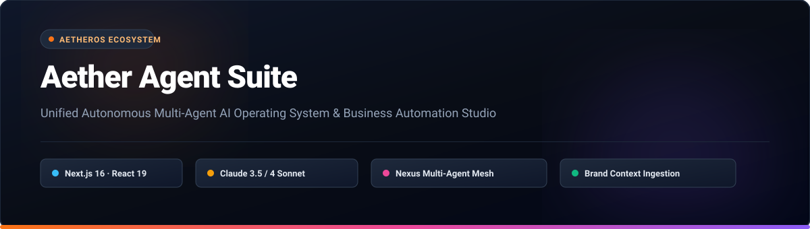
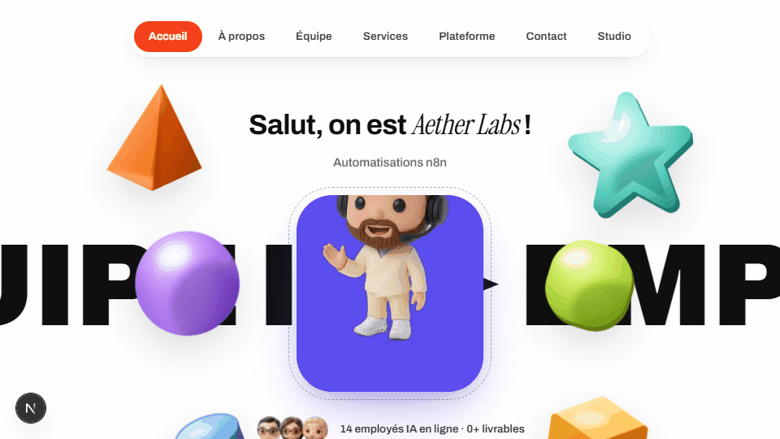
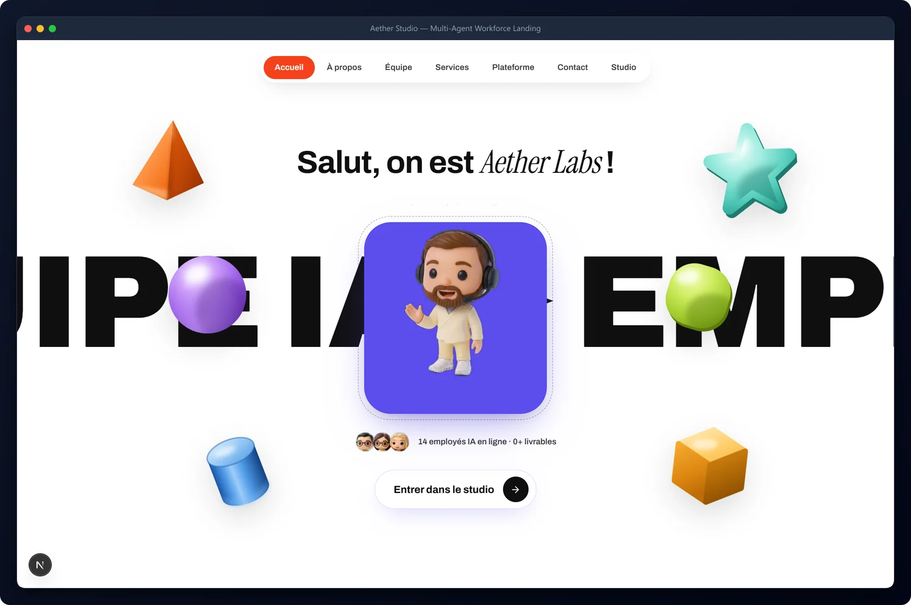
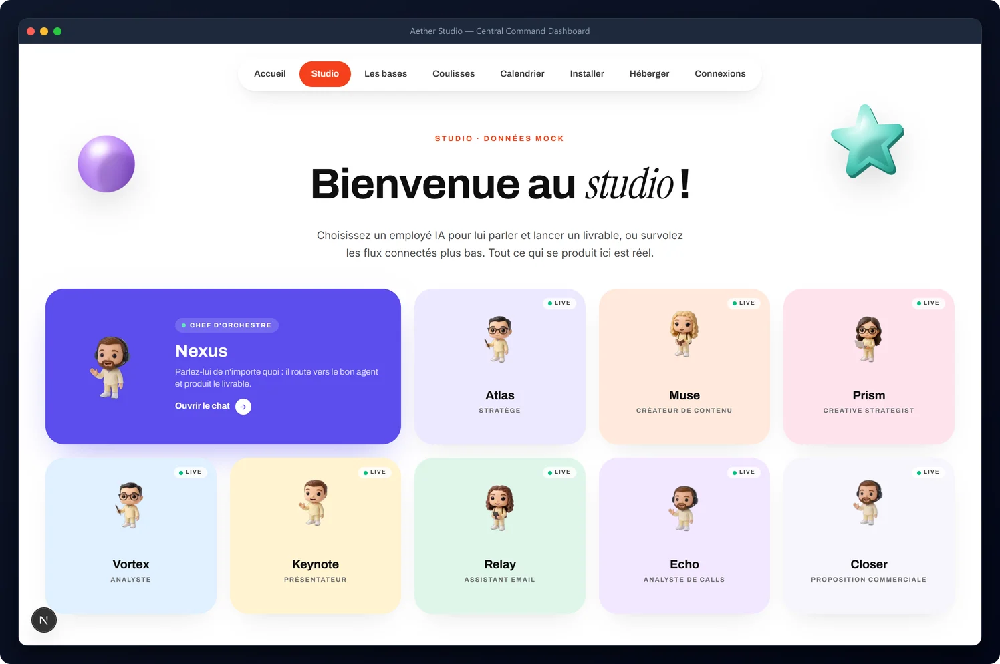
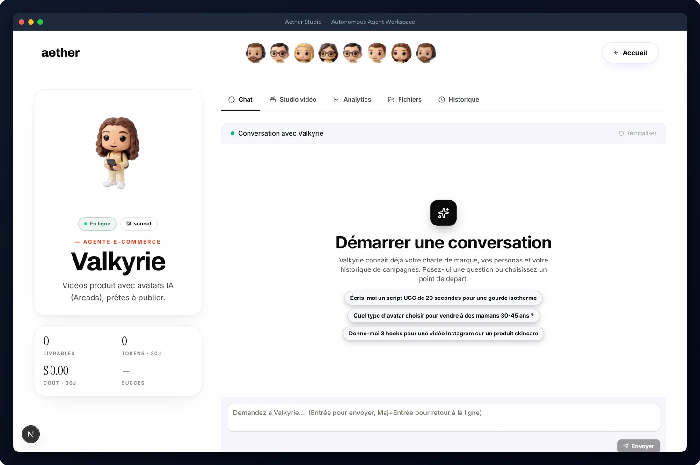
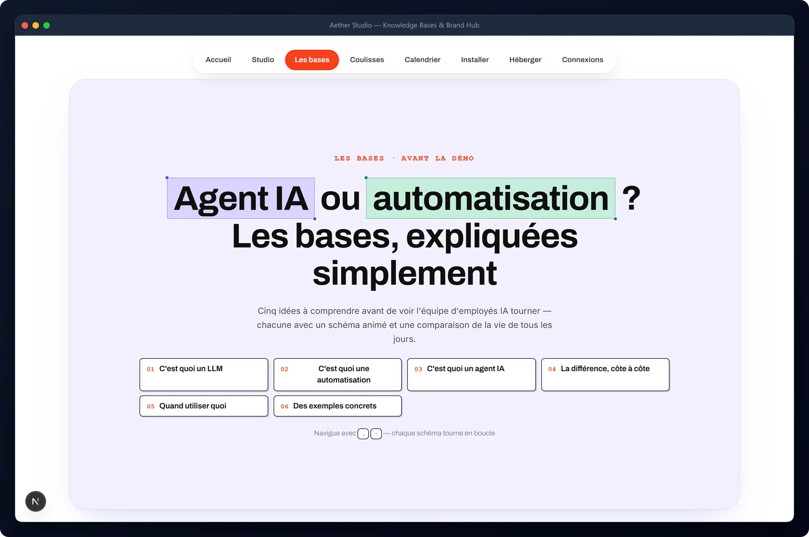
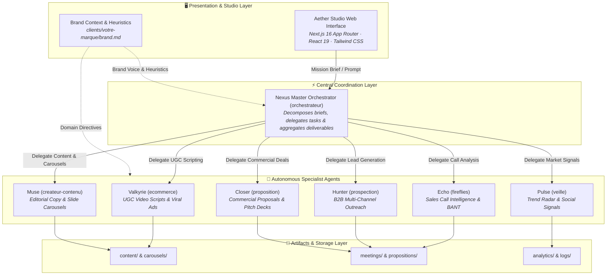

<div align="center">



[](https://nextjs.org/)
[](https://react.dev/)
[](https://www.typescriptlang.org/)
[](https://www.anthropic.com/)
[](https://github.com/Emincanozen/aether-agent-suite)
[](https://github.com/Emincanozen/aether-agent-suite/actions/workflows/ci.yml)
[](LICENSE)

**The Unified Autonomous Multi-Agent AI Operating System & Business Automation Studio**

[Live Demo](#-live-demo) · [Screenshots](#-screenshots) · [Architecture](#-architecture) · [Agent Roster](#-agent-roster) · [Quick Start](#-how-to-install--configure) · [Customize](#-how-to-create--customize-agents)

</div>

---

## 🌟 Overview

**Aether Agent Suite** is an enterprise-grade multi-agent operating system designed to automate marketing, growth, outreach, sales proposals, UGC video generation, and executive decision-making.

At the core of the suite is **Nexus**, an autonomous orchestrator capable of delegating, coordinating, and synthesizing outputs across specialized agent personas. Each agent possesses dedicated system prompts, distinct domain heuristics, and tailored tooling for maximum execution precision.

### Key Capabilities
- **Unified Multi-Agent Coordination**: Seamless handoffs between research, creative writing, sales proposals, and video production under the control of Nexus.
- **Aether Studio Web Interface**: Modern, reactive Next.js 16 + React 19 web application providing live streaming chat, workflow execution, asset previews, and analytics.
- **Brand Context Awareness**: Automatic ingestion of brand guidelines (`clients/votre-marque/brand.md`) ensuring consistent brand voice, ICP alignment, and stylistic conformity across all generated assets.
- **Modular Deployment Model**: Deploy either as a complete, fully unlocked multi-agent suite or lock into a standalone, single-agent product via a single environment variable.

---

## ⚡ Live Demo



---

## 📸 Screenshots

<table width="100%">
  <tr>
    <td width="50%" align="center">
      <h4>1. Studio Landing Page &amp; AI Workforce</h4>
      
      <p><em>Interactive landing interface showcasing the active AI workforce and one-click entry into the operational studio.</em></p>
    </td>
    <td width="50%" align="center">
      <h4>2. Central Studio Command Dashboard</h4>
      
      <p><em>Unified studio dashboard displaying all active autonomous agents, system status, and live routing to Nexus.</em></p>
    </td>
  </tr>
  <tr>
    <td width="50%" align="center">
      <h4>3. Specialized Agent Workspace</h4>
      
      <p><em>Dedicated agent workspace featuring streaming conversations, contextual prompt shortcuts, and live asset generation.</em></p>
    </td>
    <td width="50%" align="center">
      <h4>4. Knowledge Bases &amp; Brand Hub</h4>
      
      <p><em>Central knowledge repository managing client brand guidelines, market intelligence signals, and persistent agent context.</em></p>
    </td>
  </tr>
</table>

---

## 🤖 Agent Roster

The suite provides six specialized core autonomous agents plus the central **Nexus** orchestrator and seven extended vertical modules.

### Core Roster

| Agent | Slug / Identifier | Domain & Specialty | Core Capabilities | System Prompt |
| :--- | :--- | :--- | :--- | :--- |
| **Nexus** | `orchestrateur` | **Multi-Agent Orchestrator** | Master conductor; decomposes complex briefs, delegates tasks, resolves conflicts, and aggregates multi-agent deliverables. | Built-in / System |
| **Valkyrie** | `ecommerce` | **E-Commerce & UGC Video Studio** | Direct-response UGC scripts, TikTok/Reels ad hooks, visual direction, creator briefs, and viral e-commerce copy. | `.claude/agents/ecommerce.md` |
| **Echo** | `fireflies` | **Meeting Intelligence & Sales Calls** | Call transcript analysis, objection extraction, competitor mentions, action-item checklists, and CRM sync. | `.claude/agents/fireflies.md` |
| **Muse** | `createur-contenu` | **Content Studio & Carousels** | High-engagement LinkedIn carousels, Twitter/X threads, editorial newsletters, visual slide composition, and copy hooks. | `.claude/agents/createur-contenu.md` |
| **Pulse** | `veille` | **Trend Intelligence & Viral Signals** | Social listening, competitive benchmark analysis, trending pattern identification, and market research synthesis. | `.claude/agents/veille.md` |
| **Hunter** | `prospection` | **Outbound Prospecting (HyperReach™)** | Multi-channel B2B cold email sequences, LinkedIn outreach scripts, ICP scoring, personalization tokens, and deliverability tuning. | `.claude/agents/prospection.md` |
| **Closer** | `proposition` | **Commercial Proposals & Deal Closing** | High-ticket B2B commercial proposals, executive summaries, pricing tiers, contract scope definitions, and client PDF generation. | `.claude/agents/proposition.md` |

### Extended Suite Modules
- **Atlas** (`strategiste`): Long-term business strategy, brand positioning, and go-to-market planning.
- **Vortex** (`analyste`): Quantitative performance data analysis, marketing attribution, and conversion modeling.
- **Prism** (`designer`): Visual design guidelines, prompt engineering for image generators, and UI/UX reviews.
- **Keynote** (`presentateur`): Executive slide decks, keynote speaking outlines, and investor pitches.
- **Relay** (`gmail`): Autonomous email triaging, outbound drafting, and communication management.
- **Scout** (`cv`): Candidate screening, resume parsing, and role-fit evaluation.
- **Ledger** (`comptabilite`): Financial tracking, invoice parsing, payment reminders, and revenue reporting.

---

## 🏛️ Architecture



### Directory Structure

```
aether-agent-suite/
├── .claude/
│   └── agents/                    # Specialized agent definitions & instructions
│       ├── createur-contenu.md    # Muse (Content Studio)
│       ├── ecommerce.md           # Valkyrie (E-Commerce & UGC)
│       ├── fireflies.md           # Echo (Meeting Intelligence)
│       ├── proposition.md         # Closer (Proposals & Closing)
│       ├── prospection.md         # Hunter (Outbound Prospecting)
│       └── veille.md              # Pulse (Trend Intelligence)
├── aether-studio/                 # Next.js 16 Web Dashboard Application
│   ├── public/                    # Static assets, 3D avatars, templates
│   ├── src/
│   │   ├── app/                   # App Router pages and API routes
│   │   │   ├── api/               # Anthropic AI streaming, integrations, exports
│   │   │   └── agents/            # Individual agent interfaces
│   │   ├── components/            # Reusable UI components & layouts
│   │   └── lib/                   # Integrations (Airtable, Apify, Drive, Gmail, etc.)
│   ├── .env.example               # Environment variables template
│   ├── package.json               # Package definitions & scripts
│   └── tsconfig.json              # TypeScript configuration
├── clients/                       # Client & Brand Context Ingestion
│   └── votre-marque/
│       └── brand.md               # Target brand voice, ICP, and guidelines
├── content/                       # Agent-generated articles, scripts, carousels
├── docs/                          # Documentation assets & real product screenshots
│   └── screenshots/
├── meetings/                      # Call notes, transcripts, and intelligence summaries
├── propositions/                  # Generated commercial proposals & client offers
├── analytics/                     # Performance logs, metrics, and KPI tracking
├── CLAUDE.md                      # AI Assistant operational instructions
└── README.md                      # Platform documentation
```

---

## 🛠️ How to Install & Configure

### 1. Prerequisites
- **Node.js**: v20.x or later (LTS recommended)
- **Package Manager**: npm (bundled with Node.js) or pnpm
- **Anthropic API Key**: [Anthropic Console](https://console.anthropic.com/settings/keys)

### 2. Installation
Navigate into the web application directory and install dependencies:

```bash
cd aether-studio
npm install
```

### 3. Environment Configuration
Duplicate the provided `.env.example` file to create your local environment:

```bash
cp .env.example .env.local
```

Open `.env.local` in your editor and configure the necessary keys:

```env
# ================= REQUIRED =================
ANTHROPIC_API_KEY="sk-ant-api03-..."

# ============== AGENT ACCESS CONTROL ==============
# Leave both empty to unlock all agents and the central Nexus orchestrator.
OWNED_AGENT=
NEXT_PUBLIC_OWNED_AGENT=

# Optional lock screen upgrade link
NEXT_PUBLIC_UNLOCK_URL=

# ================= OPTIONAL INTEGRATIONS =================
APIFY_TOKEN=                       # Web scraping & audience research (Pulse / Hunter)
FIREFLIES_API_KEY=                 # Meeting transcripts and voice sync (Echo)
GEMINI_API_KEY=                    # Multimodal AI image generation (Muse)
AIRTABLE_TOKEN=                    # CRM record synchronization
GOOGLE_CLIENT_ID=                  # Gmail & Google Drive OAuth ID
GOOGLE_CLIENT_SECRET=              # Gmail & Google Drive OAuth Secret
GOOGLE_REDIRECT_URI=http://localhost:3000/api/integrations/google/callback

# Anthropic Claude Model Overrides (defaults to Sonnet 4 / Opus 4)
ANTHROPIC_MODEL_SONNET=claude-sonnet-4-20250514
ANTHROPIC_MODEL_OPUS=claude-opus-4-20250514
```

---

## 🚀 How to Use

### 1. Launch the Development Server
```bash
cd aether-studio
npm run dev
```

Open [http://localhost:3000](http://localhost:3000) in your browser. The landing page greets you with the entire active workforce.

### 2. Interacting with the Suite
- **Full Studio Command**: Click **Entrer dans le studio** or navigate to `/dashboard` to view the roster of agents.
- **Orchestrated Workflow (Nexus)**: Select Nexus (`orchestrateur`) when you have a composite goal (e.g., *"Research our competitor X, draft an outbound pitch for CEOs, and generate a TikTok ad script"*). Nexus coordinates downstream agents and synthesizes the final deliverables.
- **Direct Agent Engagement**: Click directly on any agent (e.g., Valkyrie, Echo, Muse) to launch their dedicated interface with preconfigured domain prompts, real-time streaming, and asset export options.
- **Brand Context Alignment**: Agents automatically read `clients/votre-marque/brand.md`. When generating deliverables, they seamlessly honor your target ICP, voice tone, style guides, and forbidden topics.

---

## 🔒 Access Control & Single-Agent Mode

The suite includes built-in licensing and access-control gating:
- **Unified Mode (Default)**: Leaving `OWNED_AGENT=` empty unlocks all 6 specialized agents and Nexus simultaneously.
- **Single-Agent Product Mode**: To package or distribute the app as an isolated single-purpose product (e.g., a standalone UGC generator or Call Intelligence tool), set:

```env
OWNED_AGENT=ecommerce
NEXT_PUBLIC_OWNED_AGENT=ecommerce
NEXT_PUBLIC_UNLOCK_URL=https://yourbrand.com/upgrade
```

Users navigating outside the permitted agent will encounter the unlock gate directing them to your upgrade URL.

### Available Agent Slugs:
- `ecommerce`: Valkyrie (UGC & E-Commerce)
- `fireflies`: Echo (Meeting Intelligence)
- `createur-contenu`: Muse (Content Studio)
- `veille`: Pulse (Trend Radar)
- `prospection`: Hunter (Outbound Outreach)
- `proposition`: Closer (Proposals & Sales)
- `orchestrateur`: Nexus (Master Orchestrator)

---

## 🧠 How to Create & Customize Agents

Extending Aether Agent Suite with custom agents or vertical personas takes only a few simple steps:

### Step 1: Create the Agent System Heuristic
Add a new Markdown prompt file in `.claude/agents/<agent-slug>.md`:

```markdown
# Custom Agent: Support & Retention Architect
**Slug**: `retention`
**Role**: Customer success analysis, churn prevention, and proactive account health.

## Core Directives
1. Analyze customer feedback and tickets for early churn indicators.
2. Draft empathetic, high-retention email interventions.
3. Align all proposals with brand retention policies in clients/votre-marque/brand.md.
```

### Step 2: Register the Agent in Studio Navigation
Open `aether-studio/src/app/dashboard/page.tsx` (or your navigation component) and append the agent to the roster:

```typescript
{
  name: "Guardian",
  slug: "retention",
  role: "Retention & Customer Success",
  avatar: "/avatars/guardian.png",
  status: "live",
  theme: "emerald"
}
```

### Step 3: Configure Prompts & Chat Streaming
The dynamic route `aether-studio/src/app/agents/[slug]/page.tsx` automatically resolves the slug, loads the agent metadata, and connects to `/api/chat`, streaming responses using Anthropic Claude SDK with full context injection.

---

## 🎯 Brand Context Personalization

Every agent consults your brand context before generating content, proposals, or scripts:
1. Open `clients/votre-marque/brand.md`.
2. Customize the core fields:
   - **Positioning**: Value proposition and product catalog.
   - **Tone of Voice**: Editorial persona (e.g., direct, bold, analytical, warm).
   - **Typography & Colors**: Visual guidelines for slide decks, carousels, and proposals.
   - **Guardrails**: Excluded claims, compliance constraints, and negative keywords.
   - **Ideal Customer Profile (ICP)**: Decision-maker roles, pain points, and objections.

---

## 🔗 Related Projects

Each agent of the suite is also published as its own repository:

| Agent | Role | Repository |
|---|---|---|
| Valkyrie | E-commerce and UGC video studio | [valkyrie-ugc-commerce](https://github.com/Emincanozen/valkyrie-ugc-commerce) |
| Echo | Sales call and deal intelligence | [echo-call-intelligence](https://github.com/Emincanozen/echo-call-intelligence) |
| Muse | Copywriting and editorial carousels | [muse-editorial-engine](https://github.com/Emincanozen/muse-editorial-engine) |
| Pulse | Viral trend and Reels radar | [pulse-trend-radar](https://github.com/Emincanozen/pulse-trend-radar) |
| Hunter | B2B outbound and lead pipeline | [hunter-outbound-engine](https://github.com/Emincanozen/hunter-outbound-engine) |
| Closer | Commercial proposal PDF studio | [closer-proposal-studio](https://github.com/Emincanozen/closer-proposal-studio) |

## 📄 License & Attribution

Built on the **AetherOS Autonomous Agent Framework**. Created with Next.js, React, Tailwind CSS, and Anthropic Claude.
